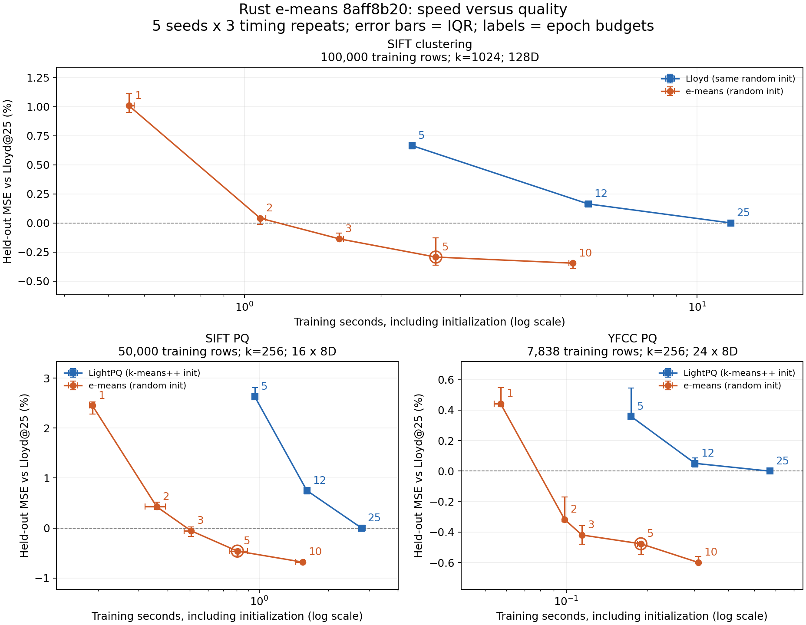
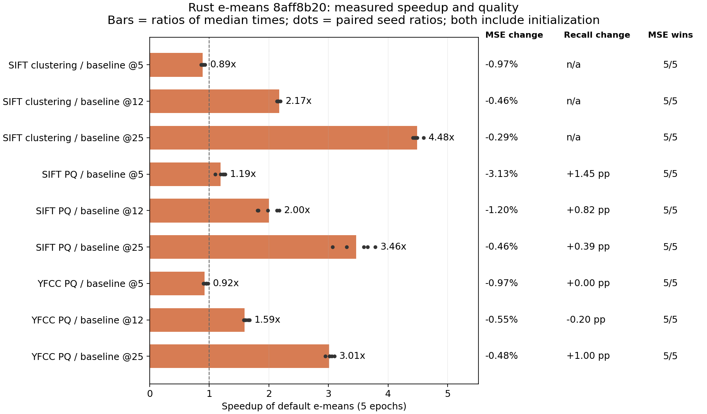

# e-means performance: 2026-11-16

360 complete timed fits: 5 seeds x 3 repeats, three cases and eight budgets.

Measured on Intel Core i9-10900X @ 3.70GHz, Windows x86-64. Build and thread configuration are recorded in environment.json. Initialization and in-RAM training preparation are included; disk I/O, scoring and logging are excluded.

The measured algorithm is commit 8aff8b20c46fc7e2789c999b78519093071d3bbc, including its composable-backend/Strided refactor. The benchmark uses the cached default SIMD backend. This replaces the earlier prototype/hardware measurements.

## Speed versus quality

Left is faster; below zero means lower held-out MSE than the corresponding Lloyd@25 baseline. Labels are independent epoch budgets, not checkpoints. The outlined point is the default e-means budget of 5 epochs. Error bars are IQRs across five seeds, not confidence intervals.

## Default e-means: five epochs

Clustering uses matched random initial centers. PQ compares actual LightPQ (k-means++ + Lloyd) with the supplied random-initialization e-means adapter. PQ therefore changes initialization and optimizer together.

| Case | Baseline epochs | Baseline seconds | e-means seconds | Speedup | Paired test MSE change | MSE wins | Paired Recall@10 change |
| --- | ---: | ---: | ---: | ---: | ---: | ---: | ---: |
| SIFT clustering | 5 | 2.3459 | 2.6474 | 0.89x | -0.972% | 5/5 | n/a |
| SIFT clustering | 12 | 5.7511 | 2.6474 | 2.17x | -0.456% | 5/5 | n/a |
| SIFT clustering | 25 | 11.8729 | 2.6474 | 4.48x | -0.293% | 5/5 | n/a |
| SIFT PQ | 5 | 0.9571 | 0.8047 | 1.19x | -3.125% | 5/5 | +1.45 pp |
| SIFT PQ | 12 | 1.6121 | 0.8047 | 2.00x | -1.203% | 5/5 | +0.82 pp |
| SIFT PQ | 25 | 2.7868 | 0.8047 | 3.46x | -0.462% | 5/5 | +0.39 pp |
| YFCC PQ | 5 | 0.1739 | 0.1894 | 0.92x | -0.970% | 5/5 | +0.00 pp |
| YFCC PQ | 12 | 0.3011 | 0.1894 | 1.59x | -0.554% | 5/5 | -0.20 pp |
| YFCC PQ | 25 | 0.5707 | 0.1894 | 3.01x | -0.476% | 5/5 | +1.00 pp |

## All measured budgets

MSE and recall changes below are paired per-seed medians relative to Lloyd@25. Negative MSE change and positive recall change are better. Speedup is the ratio of aggregate median times, after taking the median of three repeats within each seed. All three repeats must have bit-identical centers; their quality values are not independent samples.

| Case | Method | Epochs | Seconds | Test MSE | Paired MSE change | Train/test MSE wins | Recall@10 |
| --- | --- | ---: | ---: | ---: | ---: | ---: | ---: |
| SIFT clustering | lloyd | 5 | 2.3459 | 52171.379 | +0.666% | 0/5, 0/5 | n/a |
| SIFT clustering | lloyd | 12 | 5.7511 | 51880.281 | +0.164% | 0/5, 0/5 | n/a |
| SIFT clustering | lloyd | 25 | 11.8729 | 51795.564 | +0.000% | 5/5, 5/5 | n/a |
| SIFT clustering | emeans | 1 | 0.5556 | 52356.371 | +1.009% | 0/5, 0/5 | n/a |
| SIFT clustering | emeans | 2 | 1.0839 | 51800.335 | +0.041% | 0/5, 2/5 | n/a |
| SIFT clustering | emeans | 3 | 1.6200 | 51738.494 | -0.137% | 5/5, 4/5 | n/a |
| SIFT clustering | emeans | 5 | 2.6474 | 51713.599 | -0.293% | 5/5, 5/5 | n/a |
| SIFT clustering | emeans | 10 | 5.3177 | 51634.688 | -0.346% | 5/5, 5/5 | n/a |
| SIFT PQ | lloyd | 5 | 0.9571 | 11016.683 | +2.631% | 0/5, 0/5 | 60.27% |
| SIFT PQ | lloyd | 12 | 1.6121 | 10813.645 | +0.750% | 0/5, 0/5 | 60.75% |
| SIFT PQ | lloyd | 25 | 2.7868 | 10733.903 | +0.000% | 5/5, 5/5 | 61.07% |
| SIFT PQ | emeans | 1 | 0.1888 | 10995.732 | +2.451% | 0/5, 0/5 | 60.65% |
| SIFT PQ | emeans | 2 | 0.3593 | 10779.813 | +0.427% | 0/5, 0/5 | 61.47% |
| SIFT PQ | emeans | 3 | 0.5059 | 10728.121 | -0.054% | 0/5, 3/5 | 61.46% |
| SIFT PQ | emeans | 5 | 0.8047 | 10684.286 | -0.462% | 5/5, 5/5 | 61.50% |
| SIFT PQ | emeans | 10 | 1.5432 | 10664.836 | -0.681% | 5/5, 5/5 | 61.55% |
| YFCC PQ | lloyd | 5 | 0.1739 | 25334.699 | +0.360% | 0/5, 0/5 | 64.50% |
| YFCC PQ | lloyd | 12 | 0.3011 | 25244.386 | +0.051% | 0/5, 0/5 | 64.50% |
| YFCC PQ | lloyd | 25 | 0.5707 | 25229.767 | +0.000% | 5/5, 5/5 | 63.50% |
| YFCC PQ | emeans | 1 | 0.0570 | 25343.788 | +0.443% | 0/5, 0/5 | 64.00% |
| YFCC PQ | emeans | 2 | 0.0987 | 25163.730 | -0.317% | 0/5, 5/5 | 64.50% |
| YFCC PQ | emeans | 3 | 0.1144 | 25131.188 | -0.419% | 5/5, 5/5 | 65.10% |
| YFCC PQ | emeans | 5 | 0.1894 | 25100.317 | -0.476% | 5/5, 5/5 | 64.30% |
| YFCC PQ | emeans | 10 | 0.3097 | 25085.731 | -0.599% | 5/5, 5/5 | 65.20% |

## Limits and reproducibility

- This is CPU training performance, not GPU performance or end-to-end DiskANN index construction.
- Recall is exhaustive f64 PQ ADC against f64 exact squared-L2 ground truth, using the production byte encoder. It is not graph-search recall/QPS.
- SIFT retrieval uses 100,000 database vectors and the first 1,000 supplied queries; YFCC uses 10,000 vectors and 100 queries. The small YFCC query set limits generalization.
- Lower reconstruction MSE does not imply better recall. Both metrics and per-seed results are retained.
- Fixed budgets do not establish that Lloyd cannot improve after 25 iterations. No universal 10x claim follows from these cases.
- [Method and reproduction commands](../../README.md)
- [Exact run configuration](config.json)
- [Raw measurements](measurements.jsonl)
- [Full statistics, including individual seeds and repeat timings](summary.json)
- [Dataset hashes and split provenance](datasets.json)
- [Measured source, binary and hardware metadata](environment.json)
- [Dependency lock snapshot](dependency-lock.toml)

For exact dependency versions, copy dependency-lock.toml to Cargo.lock in a fresh checkout of the recorded benchmark commit before building with --locked.
